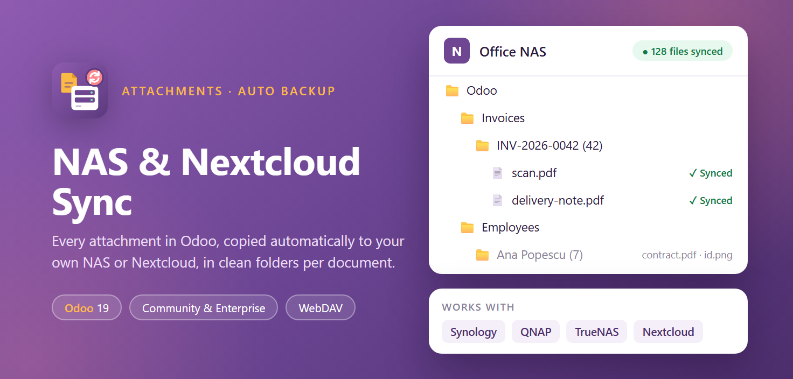

# NAS & Nextcloud Sync (WebDAV)



Copy **Odoo attachments automatically to your own NAS or Nextcloud**, in clean,
human-readable folders.

Files attached in Odoo (scanned invoices, signed contracts, employee documents, ...)
normally live only inside the Odoo database or filestore. This module copies them over
WebDAV to a Synology, QNAP, TrueNAS, Nextcloud / ownCloud or any other WebDAV server,
one folder per document type and, optionally, one sub-folder per record. Anyone in the
office can then find them from Windows Explorer, Finder or the NAS app:

```
Odoo/
└── Invoices/
    └── INV-2026-0042 (42)/
        ├── scan.pdf
        └── delivery-note.pdf
```

- **Version:** 19.0
- **Depends on:** `base`, `mail` (Python: `requests`)
- **Editions:** Community and Enterprise, Odoo.sh or on-premise
- **License:** OPL-1

## Features

- Several NAS servers, each with its own **sync rules** (*What to sync*):
  - document type (any Odoo model: invoices, sale orders, employees, projects, ...);
  - folder name on the NAS and optional **one folder per record**;
  - optional **record filter** (domain), with `uid`, `user`, `company_id`,
    `company_ids`, `context_today()` and `relativedelta` available;
  - optional **only files created after** date, to skip old attachments.
- Scheduled upload every 15 minutes, plus **Sync now** and **Test connection** buttons.
- **Changed files are uploaded again** over the same remote file; renaming an attachment
  in Odoo does not create a new copy.
- Duplicate file names in the same folder get the attachment id as suffix
  (`scan (57).pdf`), so nothing is overwritten by mistake.
- Optional: **delete the NAS copy** when the attachment is deleted in Odoo. The remote
  file is removed only after the deletion is committed in Odoo.
- **Sync log** with status, number of attempts and error message per file; failed uploads
  are retried up to 5 times, then wait for a one-click **Retry errors**.
- Safe for big backlogs and parallel use:
  - one sync at a time per server (a manual sync during a running one gets a clear message,
    the scheduled job skips that server);
  - the scheduled job saves its progress after every file and stops cleanly when its time
    budget is spent, continuing on the next run;
  - a batch size limits how many files are uploaded per run.
- Self-signed certificates supported (*Verify SSL certificate* option, for a local NAS).
- Only administrators (*Settings* access) see the module and the sync log.

## Configuration

### 1. Prepare the server

| Server | What to enable | URL to use |
|---|---|---|
| Synology DSM | *WebDAV Server* package, HTTPS (port 5006) | `https://your-nas:5006` |
| QNAP QTS | *Control Panel → Web Server → WebDAV* | `https://your-nas/webdav` or the share URL |
| TrueNAS | WebDAV service and a share | the share URL |
| Nextcloud / ownCloud | an **app password** (*Settings → Security*) | `https://cloud/remote.php/dav/files/USERNAME` |

The Odoo server must be able to reach the NAS (public HTTPS address, VPN or same network).

### 2. Add the server in Odoo

*NAS Sync → Servers → New*: server type, WebDAV URL, username, password and the root
folder (default `Odoo`, created if missing). Click **Test connection**.

### 3. Choose what to sync

Tab **What to sync**: add one line per document type, then click **Sync now** or wait for
the scheduled job. Uploaded files and errors are listed in *NAS Sync → Sync Log*.

## Technical notes

- `models/webdav_client.py`: minimal WebDAV client (`PROPFIND`, `MKCOL`, `PUT`, `DELETE`)
  built on `requests`, with no Odoo imports. Folders are created like `mkdir -p` and
  cached per run; file and folder names are made safe for every NAS (`safe_name`).
- `webdav.backend`: a server, its options and the sync logic (`_sync`). A transaction-level
  PostgreSQL advisory lock allows one sync per server. The cron (`_cron_sync`) calls
  `ir.cron._commit_progress` after every file.
- `webdav.sync.rule`: what to sync. The record filter is evaluated with `safe_eval`,
  validated on save and applied as a sub-query.
- `webdav.sync.item`: one line per (server, attachment), unique, with state
  `pending` / `done` / `error`, remote path and checksum.
- `ir.attachment`:
  - writing `datas` / `raw` sets the item back to `pending` (re-upload);
  - `unlink` deletes the remote copy in a post-commit hook, and only for attachments
    that really no longer exist.
- Only attachments with `type = binary`, a `res_model` / `res_id` and no `res_field`
  (i.e. real attachments, not binary fields) are synced.

## Tests

```bash
odoo-bin -d <test_db> --addons-path=<odoo>/addons,<path to this repo> \
    -i nas_webdav_sync --test-enable \
    --test-tags /nas_webdav_sync --stop-after-init
```

The suite (`tests/test_sync.py`) runs against an in-process mock WebDAV server
(`tests/mock_dav.py`), so it needs neither a NAS nor internet access. It covers folder
layout and duplicate names, retries, batch size and record filters, an unreachable server,
remote deletion (including a rolled back deletion), deleted records, access for regular
users, re-upload of changed files, the unique constraint, one sync per server and the
cron's intermediate commits.

## Support

Author: Sostenia (<https://www.sostenia.ro>). For support or customization requests,
please contact the author.
